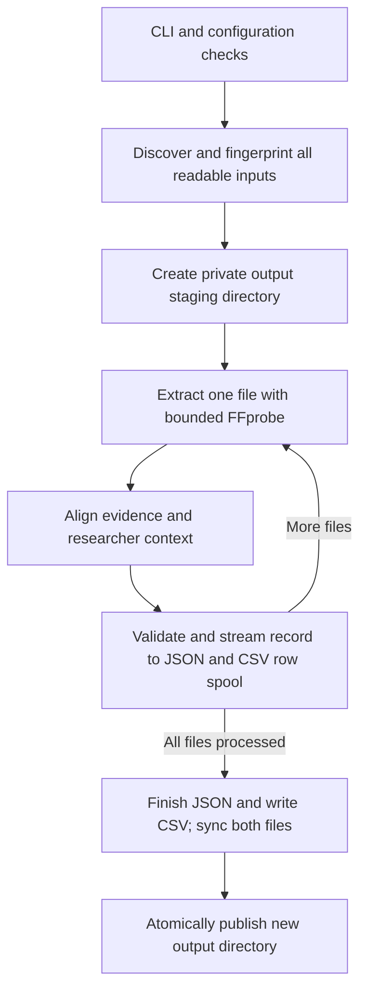

# PyVMM

Local video import → FFprobe extraction → BeStMeta alignment → JSON/CSV export.
Python 3.11+, the three pinned Python dependencies, and a native FFprobe executable
are required. Windows and Linux publication are supported.

The project contains five pipeline scripts, one pinned schema, requirements,
licence, this guide, and one portable regression-test module.

## 1. Install once

Open PowerShell in this project folder. Install Python 3.11 or newer and obtain
FFprobe through [FFmpeg's download page](https://ffmpeg.org/download.html).
Use your actual FFprobe path below; PyVMM downloads no executables.

```powershell
py -3 -m venv "$env:LOCALAPPDATA\pyvmm-venv"
$python = "$env:LOCALAPPDATA\pyvmm-venv\Scripts\python.exe"
& $python -m pip install -r .\requirements.txt
if ($LASTEXITCODE -ne 0) { throw 'Dependency installation failed' }
$ffprobe = 'C:\tools\ffmpeg\bin\ffprobe.exe'
& $ffprobe -version
& $python -B .\main.py --help
```

The environment stays outside the project files. In a new PowerShell session,
set `$python` and `$ffprobe` again. On Linux, create a virtual environment outside
the project, install `requirements.txt`, and use its Python with the same CLI.

## 2. Run on your existing test data

Use fully local, readable files that remain unchanged during the run. For OneDrive,
make the recordings available offline first. Replace only the input path below.

```powershell
$data = 'D:\your\existing-test-data'
$results = Join-Path $env:TEMP ('pyvmm-check-' + [guid]::NewGuid().ToString('N'))
& $python -B .\main.py "$data" -o "$results" --ffprobe "$ffprobe"
$runExit = $LASTEXITCODE
Write-Host "Exit: $runExit; results: $results"
```

An input may be one file, a folder, or several space-separated quoted paths.
Folders are searched recursively using `VIDEO_EXTENSIONS` in `import.py`;
explicit files are probed regardless of suffix. Symlinks and Windows junctions
are skipped. Repeated paths are deduplicated; identical content at different
paths remains separate records with a warning. Check the discovered file count
against your own inventory, including any skipped or unsupported files.

The output directory must **not exist**. Every run needs a new name; PyVMM refuses
to overwrite an existing destination, including one created concurrently.
Only `metadata.json` and `metadata.csv` are published, after both finish.

| Exit | Meaning |
| --- | --- |
| 0 | Every record passes schema and scientific checks; no import errors. |
| 1 | Results exported, but records are drafts or input errors occurred. |
| 2 | Configuration or export failed; inspect the terminal error. |
| 130 | Interrupted. |

A first run without study metadata normally returns **1**. This preserves useful
extracted evidence while reporting missing scientific context. Exit 0 means
validation passed; it does not establish that supplied scientific facts are true.

## 3. Supply real scientific context

Create your own UTF-8 JSON file outside the project, for example `study.json`:

```json
{
  "bestmeta": {
    "dataset_id": "your-study-id",
    "dataset_title": "Your actual study title",
    "dataset_license": "CC-BY-4.0"
  },
  "annotations": {
    "note": "Your optional custom information"
  }
}
```

This shows the structure, **not complete metadata**. Use your actual licence and
facts. Fill the applicable fields reported in `validation.missing_required` and
`validation.errors`, consulting their `schema_path` in `bestmeta_schema.json`.
Conditional alternatives may be reported: choose the scientifically applicable
branch. Hardware lives under `hardware_and_acquisition.hardware`; acquisition
settings live under `hardware_and_acquisition.acquisition`. Timestamps need an
explicit UTC offset or `Z`. Custom information belongs in `annotations`.
Supply acquisition `frame_rate` and `recording_duration` from experimental context.
The file's encoded playback rate and duration cannot establish capture timing:
time-lapse, slow-motion, and edited recordings can have different time scales.
These file measurements remain in `extraction.technical`; they are not automatically
promoted to acquisition facts. Unknown acquisition timing correctly remains a draft.

```powershell
$metadata = 'D:\your\study.json'
$results = Join-Path $env:TEMP ('pyvmm-enriched-' + [guid]::NewGuid().ToString('N'))
& $python -B .\main.py "$data" -o "$results" --ffprobe "$ffprobe" --metadata "$metadata"
$runExit = $LASTEXITCODE
```

The same metadata is applied to **every input recording**. Run separately when
recordings require different context. Annotations cannot replace conflicting
measurements: both candidates are retained, the measured value remains selected,
and the record is invalid. An explicit dataset identifier may replace the default
SHA-256 identifier. Each record is a file-centric BeStMeta view, not a merged study.

## 4. Check the results locally

Run this in the same PowerShell session after either run. It independently checks
the exported source hashes, CSV hash/validity columns, and summary counts, and prints
all per-record findings. It reads every input again, so allow time for large files.
This check loads the output JSON into memory; use manageable batches for large datasets.

```powershell
@'
import csv, hashlib, json, sys
from pathlib import Path
csv.field_size_limit(64 * 1024 * 1024)
folder = Path(sys.argv[1])
if {p.name for p in folder.iterdir()} != {"metadata.json", "metadata.csv"}:
    raise SystemExit("Unexpected output files")
document = json.loads((folder / "metadata.json").read_text(encoding="utf-8"))
records, summary = document["records"], document["summary"]
with (folder / "metadata.csv").open(encoding="utf-8-sig", newline="") as stream:
    rows = list(csv.DictReader(stream))
if len(records) != len(rows) or summary["files"] != len(records):
    raise SystemExit("Record counts disagree")
valid = sum(record["validation"]["valid"] for record in records)
if (summary["valid"], summary["draft"]) != (valid, len(records) - valid):
    raise SystemExit("Validation counts disagree")
for record, row in zip(records, rows):
    asset = record["extraction"]["asset"]
    with Path(asset["path"]).open("rb") as stream:
        digest = hashlib.file_digest(stream, "sha256").hexdigest()
    if digest != asset["sha256"] or row["sha256"] != digest:
        raise SystemExit(f"Source hash differs: {asset['path']}")
    if row["valid"] != str(record["validation"]["valid"]):
        raise SystemExit(f"CSV validity differs: {asset['path']}")
    print(asset["relative_path"], json.dumps(record["extraction"]["technical"]))
    for name in ("issues", "conflicts", "validation"):
        print(name, json.dumps(record[name], ensure_ascii=True))
print("import_issues", json.dumps(document["import_issues"]))
print("summary", json.dumps(summary))
print("PASS: hashes, CSV validity, and counts; review scientific findings above")
'@ | & $python -B - "$results"
if ($LASTEXITCODE -ne 0) { throw 'Output verification failed' }
```

For representative recordings, compare `extraction.technical` and the aligned
`bestmeta` values with your independently known dimensions, codec, frame rate,
duration, timestamps, and acquisition settings. Inspect `provenance` for the source
and transformation of every mapped field. Re-running the same FFprobe checks
the wrapper's consistency, not the independent truth of FFprobe's measurements.
The original selected stream and all other streams remain in `extraction.raw`.
Multiple video streams select the default, then lowest index, with a warning.

Use exact `frame_rate_rational` and `duration_rational` for file playback timing.
They do not calibrate elapsed experimental time. For example, the
[published Vibrio movie](https://journals.plos.org/plosbiology/article?id=10.1371/journal.pbio.1002517)
was acquired at 1 FPS but its downloaded AVI plays at 10 FPS. Researcher-supplied
capture timing is therefore independent of file playback timing and is accepted
without a false conflict. Conflicts with actual file measurements such as width
remain errors. Acquisition duration is never guessed from frame count and rate.
Unknown frame counts remain absent: even a valid MKV can omit them. No count is
inferred from rate × duration. Container/filesystem creation time and encoder
name are not evidence of recording time or acquisition software. A multi-stream
container's duration cannot establish an individual stream's duration.

Check failure behavior locally using your own data: rerun against an existing
output folder (exit 2, original outputs unchanged); include a missing path beside
a good recording (exit 1, good recording retained and import error reported);
and supply a deliberately conflicting measured field in a **copy** of your
metadata (exit 1, conflict retained). Use new output names for the latter checks.
Then correct the metadata, rerun, and review remaining errors and warnings.

If your acceptance criteria include video decodability, use FFmpeg separately
from metadata extraction. This reads every video frame and can take substantial
time. It caught a damaged final packet that all four tested metadata parsers
accepted. Set your own single-recording path below; no media output is written.

```powershell
$ffmpeg = 'C:\tools\ffmpeg\bin\ffmpeg.exe'
$testVideo = 'D:\your\existing-test-data\recording.mp4'
& $ffmpeg -nostdin -v error -xerror -i "$testVideo" -map 0:v -f null -
if ($LASTEXITCODE -ne 0) { throw 'Video decoding failed' }
```

This checks decoding of the video streams, not the truth of acquisition metadata.
See [FFmpeg's error handling](https://ffmpeg.org/ffmpeg.html#Advanced-options).

## Full pipeline logic



1. **Preflight — `main.py`.** Parse inputs, new output path, optional metadata,
   and FFprobe path. Reject an existing destination, verify the pinned schema,
   read and check the annotation envelope, then inspect FFprobe. Record schema,
   source-code and annotation identities plus Python, dependency and tool versions.
   Schema, annotation-envelope and backend configuration errors stop before video
   hashing. Destination creation and write permissions are checked when staging
   begins.
2. **Import — `import.py`.** Discover local paths deterministically. Directory
   searches use the suffix allowlist; explicit files go to content probing
   regardless of suffix. Skip symlinks/junctions and the output subtree. Deduplicate
   repeated paths; retain equal-content files at different paths. Hash each regular
   file with bounded memory and before/after identity checks. Collect failures
   beside successful assets. All discovery and hashing finish before extraction.
3. **Extract — `extract.py`.** Check the imported file identity, then run native
   FFprobe with local-file/demuxer restrictions and time/output limits. Retain the
   configured raw sections, command and diagnostics. Select a non-cover video
   stream by default disposition, then lowest index. Read dimensions, codec,
   pixel format, available header count and exact rational playback timing.
   Recheck identity afterward. Operational failures become issues on that file;
   unavailable values remain absent.
4. **Align — `align.py`.** Create a SHA-based file-view identifier; map justified
   file measurements and controlled codec/container values into BeStMeta. Merge
   the shared researcher context. Preserve both candidates and provenance when
   they conflict; only an explicit dataset ID may replace the generated identifier.
   Keep acquisition timing independent of playback. Validate the pinned schema,
   unknown fields, usable required values, physical ranges and timestamp ordering.
   Return a valid record or a draft with actionable findings.
5. **Export — `export.py`.** Drive extraction/alignment lazily, one file at a time.
   Check record contracts, stream authoritative JSON, and spool flattened CSV rows
   privately while collecting columns. Finish the summary, write escaped CSV,
   close the spool and sync both outputs. Publish the staging directory atomically
   only if the destination is still absent. A failed export removes staging;
   an existing destination is preserved.
6. **Result — `main.py`.** Print the summary and return the documented exit code.
   Drafts and per-file input/probe errors are useful exported results (exit 1).
   Configuration, infrastructure or export failures abort publication (exit 2);
   interruption returns 130. Review import issues as well as record findings.

The boundaries are ordinary dictionaries, with no global per-run mutable state:

| Function | Input → output contract |
| --- | --- |
| `import_files(inputs, exclude_paths=...)` | Paths → `(assets, import_issues)`. Each asset carries absolute/relative paths, SHA-256 and the shared five-field file identity. |
| `extract_metadata(asset, ffprobe=...)` | Imported asset → `asset`, `raw`, `technical`, `issues`, `tool`. |
| `align_metadata(extraction, annotations)` | Extraction and optional context → `extraction`, `bestmeta`, custom `annotations`, `provenance`, `conflicts`, `issues`, `validation`. Inputs remain unmodified. |
| `export_metadata(records, output, ...)` | Record iterable and run/import/schema information → published JSON/CSV and summary. Consume this only with trusted in-process records; the private spool is never an input format. |

These functions are callable directly from Python. Because `import` is a Python
keyword, load that stage with `importlib.import_module("import")`. The CLI remains
the entry point that performs all configuration and reproducibility checks.

## Maintaining and adapting the core

Keep behavior in its owning stage and preserve the boundary fields above. A new
technical field automatically reaches JSON and the flattened CSV; projecting it
into BeStMeta requires an explicit, scientifically justified mapping.

| Intended change | Smallest owning location |
| --- | --- |
| Folder-discovery suffixes | `import.py`: `VIDEO_EXTENSIONS` |
| Source identity semantics | `import.py`: `file_identity`; extraction reuses it |
| Probe format support or bounds | `extract.py`: `SUPPORTED_DEMUXERS`, `_run_bounded`, `extract_metadata` |
| Technical measurements | `extract.py`: `_technical` and its timing helpers |
| BeStMeta projection or vocabulary | `align.py`: `_DIRECT_FIELDS`, `_CODECS`, `_measurements`, `_container_observation` |
| Scientific constraints | `align.py`: `_supplemental_errors`, `_numeric_error`, `_temporal_errors`, `_validate` |
| Context merging, conflicts or evidence | `align.py`: `_Alignment` |
| CSV presentation | `export.py`: `_row`, `_flatten`, `_csv_cell` |
| Output transaction | `export.py`: `_staged_output`, `_publish` |
| CLI and run provenance | `main.py`: `main` |

Change one owner at a time. Preserve exact timing evidence, absence of unknown
values, conflict history, source immutability and no-overwrite publication.
Remove a mapping by removing its projection, while retaining the raw observation.
For a schema upgrade, review the new schema, mappings and scientific constraints
together; update the commit and canonical hash deliberately and compare outputs.
For a backend upgrade, record the new version and rerun representative real files
as well as the regression checks. Tests with a fake probe cannot establish a
native backend's format support or scientific accuracy.

The pinned schema's explicitly anchored identifiers, durations, versions and
email patterns require complete values. Supplemental checks reject trailing
newlines and enforce ASCII digit classes; Unicode and multiline free text remain
supported. This follows the schema's
[ECMA-262 regex dialect](https://json-schema.org/draft/2019-09/json-schema-core#rfc.section.6.4),
whose [digit class means 0–9](https://tc39.es/ecma262/multipage/text-processing.html#sec-compiletocharset).
Review these assumptions when changing the pinned schema.

The single `test_pipeline.py` file retains portable regression checks using
Python's standard-library `unittest`; no test dependency is required. From this
folder, with the installed environment:

```powershell
$env:PYVMM_FFPROBE = $ffprobe
& $python -B -m unittest -v test_pipeline
if ($LASTEXITCODE -ne 0) { throw 'Pipeline regression checks failed' }
```

Setting `PYVMM_FFPROBE` also runs native invalid-video handling. Without it, that
check skips; symlink creation skips if the OS denies permission. The other checks
use a controlled probe response and exercise actual import, alignment and export,
including valid/draft CLI outcomes, process limits, malformed scientific values,
missing dependency information and rollback. If cleanup fails, the CLI preserves
the original failure or interruption and reports the cleanup problem alongside it.

Keep these checks with the source when sharing or versioning the pipeline. Add a
regression for a real defect before fixing it, then run the checks and the local
data-validation procedure above. Preserve independently known measurements for
your representative recordings. Dependency and schema pins make upgrades explicit;
they still need periodic compatibility/security review. No finite test set or
architecture can guarantee every format or unlimited future compatibility.

## Library selection

| Stage | Selected implementation | Strongest alternatives considered |
| --- | --- | --- |
| Import | `pathlib`, `os`, `stat`, `hashlib`; content probing in extraction | `python-magic` classifies headers but cannot establish video integrity. A second format gate adds no demonstrated benefit here. |
| Extraction | Native FFprobe through bounded `subprocess` | PyAV for direct decoding; MediaInfo for independent inspection. Hachoir exposed less timing and tag detail in the tested corpus. |
| Alignment and validation | Explicit Python mapping, pinned BeStMeta JSON Schema, `jsonschema`, explicit RFC checks | LinkML for schema authoring/upgrades. Pydantic needs strict configuration and another model representation; `linkml-map` adds an evolving transformation language. |
| Export | `json`, `csv`, and native filesystem APIs | pandas/Pandera suit tabular analysis; LinkML serializers/RDFlib suit additional semantic formats. Neither is needed for the two required outputs. |

On 2026-10-31, FFprobe 9.0.2, PyAV 16.1.0, pymediainfo 7.0.1, and Hachoir 3.4.0
were each exercised on the same 17 controlled fixtures: MP4/MOV/AVI/MKV, HEVC,
16-bit grayscale, fractional/variable rates, multiple streams, renamed files,
Unicode paths, non-video inputs, truncation, playlists, and damaged payload.
The current extractor passed all 17 fixture acceptance checks. python-magic
0.4.27/libmagic 5.45 was also tested on all 17 under Linux: it identified a
renamed JPEG correctly but classified a truncated MP4 as video. PyAV 19.0.2
stalled during import on the tested Windows/Python 3.12.14 setup; this is a local
compatibility result, not a claim about other installations.

FFprobe and PyAV retained the exact `30000/1001` rate and `1001/3000` second
duration of the fractional-rate fixture. MediaInfo exposed exact rate components
alongside rounded convenience values; its reported duration was 334 ms.
PyAV represented the unknown MKV frame count as zero; the pipeline keeps it absent.
Successful parsing alone was insufficient to reject every unusable input.

Focused Pydantic 2.14.1 tests accepted coercion, discarded extras, and NaN with
default settings; explicit strictness, forbidden extras, and finiteness settings
rejected them. This was a small model test, not full BeStMeta equivalence.
The JSON finite-value guard remains necessary alongside schema validation.
Large-field export tests also exposed the default CSV reader limit; the checker
above now accepts tested escaped fields of 15,000,004 characters.

Refinement checks kept MediaInfo's fractional duration at 334 ms with both
`parse_speed=1` and native JSON output (tested native library: 24.12).
PyAV 16.1 also rejected images/playlists when given explicit format/protocol
allowlists. These capabilities are configurable; adopting it would still require
the pipeline's process bounds, source checks, mapping, and evidence handling.

[FFprobe](https://ffmpeg.org/ffprobe.html),
[PyAV](https://pyav.basswood.io/docs/stable/),
[MediaInfo API](https://pymediainfo.readthedocs.io/en/stable/pymediainfo.html),
[LinkML validator](https://linkml.io/linkml/code/validator.html), and
[linkml-map status](https://github.com/linkml/linkml-map#readme) describe the
relevant interfaces and limitations. LinkML's default validation path uses JSON
Schema; it recommends that plugin over its less complete Pydantic plugin.
Using the already published BeStMeta JSON Schema avoids regenerating it at runtime.

Package distinctions: PyYAML is not part of Python's standard library;
pymediainfo wraps a native library, bundled in supported wheels.
[Hachoir's source licence](https://github.com/vstinner/hachoir/blob/main/COPYING)
is GPLv2, rather than the MIT licence suggested in the candidate list.
[FFmpeg's licence](https://ffmpeg.org/legal.html) depends on its build options.

For CZI, ND2, OME-TIFF, or other microscopy formats outside this pipeline's scope,
[BioIO with a format-specific reader](https://bioio-devs.github.io/bioio/) or
Bio-Formats is a separate candidate. Those readers were not tested without
representative microscopy files. No claim of proprietary-format support is made.

## Scientific validation and proposal coverage

On 2026-11-01, ten unchanged public scientific recordings were tested from PLOS,
eLife, Nature/PhotoniX, and NASA: fish behaviour, echocardiography, gut microscopy,
droplet experiments, and solar observations. The 89,056,190-byte corpus covers
MP4, MOV, AVI, and WebM; H.264, MPEG-4, MJPEG, VP8, and raw BGR video. All ten
selected video streams fully decoded, totalling 9,341 frames. Every available
header frame count agreed with decoding; WebM's absent count remained absent.
Original SHA-256 hashes remained unchanged. These are bounded corpus results,
not a claim of universal scientific-format or corruption detection coverage.

The public recordings exposed the capture/playback distinction above, including
[48 Hz heart acquisition versus 30 FPS playback](https://journals.plos.org/plosone/article?id=10.1371/journal.pone.0115604)
and [1000 FPS droplet acquisition versus 10 FPS playback](https://www.nature.com/articles/ncomms3517).
The pipeline retains exact file timing and accepts independently sourced capture
timing without conflating the two. Missing study facts are never fabricated to
make a public example pass BeStMeta validation.

The four-page proposal describes a larger project than this minimal core:

| Proposal requirement | Current implementation |
| --- | --- |
| WP1: library comparison and BeStMeta requirements | Candidate assessment above; pinned schema and scientific validation. Proprietary microscopy readers remain unvalidated. |
| WP2: reusable extraction, enrichment, CSV/JSON export | Four stage functions and CLI; annotations remain linked artifacts identified by source hashes, rather than rewritten video tags. |
| WP2: comprehensive metadata access | All data in the configured FFprobe format, stream, chapter, program, and version sections are retained. Stream-group, packet/frame metadata and proprietary tags are not promised. |
| WP2: released Python package, GitHub, CI, DOI | Local script core with portable regression checks and additional external QA. No package release, hosted CI, public repository, or DOI was created. |
| WP3: public scientific validation and tutorial | Public corpus, full-decode/reference checks, failure stress tests, and usage instructions; partner/private datasets were unavailable. |
| WP3: Galaxy XML, workflow and Tool Shed release | Not implemented in this minimal core. The broader proposal is therefore not fully delivered. |

## Scope and reproducibility

`main.py` calls only `import.py`, `extract.py`, `align.py`, and `export.py`.
Import owns the file-identity snapshot shared with extraction. The only dependency
between stages is `extract.py` → `import.py`; the module graph remains acyclic.
Alignment keeps measurement writes, provenance, and conflict decisions together.
FFprobe is the sole media backend. `jsonschema` and the two explicit RFC format
validators check the unmodified BeStMeta draft 0.1.0 schema at revision
`6bf77e27fe274481c06ee9e4b52e2befdcdb36d7`; its canonical hash is checked offline.
Schema identity, hashes of the five pipeline scripts, Python/library/tool versions,
annotation hash, raw extraction,
provenance, conflicts, and findings are retained in authoritative `metadata.json`.
CSV is a viewing format: formula-like text is escaped; arrays remain JSON;
literal `.`/`~` in keys become `~1`/`~0`. See `LICENSE` for attribution.

Default limits are 60 seconds and 16 MiB of combined probe output per recording;
annotation JSON is limited to 16 MiB and 64 levels. Probe limits bound elapsed time
and captured output; they do not impose an OS-level RAM cap. Only supported self-contained
local video formats are probed; playlists, image sequences, and remote protocols
are excluded. Extraction does not perform a full decode/corruption scan, read
proprietary microscopy formats, or synchronize clocks between recordings.
Source files are never modified. Identity checks detect observable changes but
do not provide an immutable snapshot of concurrently edited recordings.

